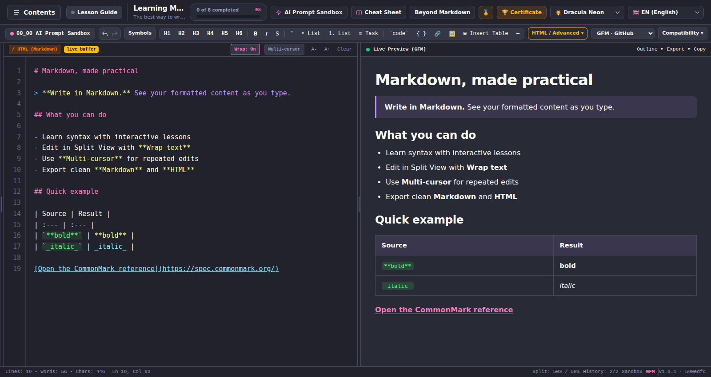

# Learning Markdown

**Write Markdown, see the result, and learn by doing — all in one browser tab.**

Learning Markdown is a free-to-use, interactive Markdown course and writing studio. Work through short, checked lessons or open the AI Prompt Sandbox and start writing immediately. The editor puts Markdown source beside a live, safely rendered preview; formatting tools, advanced HTML options and export controls are there when you need them.

Your document drafts and learning progress stay in your browser. No account, server-side project or AI API key is required.

**[Open Learning Markdown](https://shafranek-js.github.io/learning-markdown/)** · [Cloudflare Pages](https://learning-markdown.pages.dev/) · [Browse the source](https://github.com/shafranek-js/learning-markdown) · [Report an issue](https://github.com/shafranek-js/learning-markdown/issues)

*The actual browser interface: source editor, Live Preview, Markdown formatting tools and the Wrap text control. Captured automatically from the production build with an example document.*

> **Project status:** actively developed, installable PWA. The application displays its package version and short Git revision in the footer so you can identify the running build. Refer to [Known limitations](#known-limitations) before relying on advanced HTML outside this app.

## Contents

- [What you can do](#what-you-can-do)
- [A quick tour](#a-quick-tour)
- [Lesson Guide and editor workspace](#lesson-guide-and-editor-workspace)
- [View menu](#view-menu)
- [File menu](#file-menu)
- [Edit menu](#edit-menu)
- [Settings menu](#settings-menu)
- [Help menu](#help-menu)
- [Multi-document Sandbox tabs](#multi-document-sandbox-tabs)
- [Prompt Library and Builder](#prompt-library-and-builder)
- [Learn Markdown](#learn-markdown)
- [Editing and shortcuts](#editing-and-shortcuts)
- [Compatibility and export](#compatibility-and-export)
- [Install and use offline](#install-and-use-offline)
- [How it works](#how-it-works)
- [Repository layout](#repository-layout)
- [Getting started](#getting-started)
- [Scripts and tests](#scripts-and-tests)
- [Deployment](#deployment)
- [Known limitations](#known-limitations)
- [Documentation and roadmap](#documentation-and-roadmap)
- [Attribution and license](#attribution-and-license)

## What you can do

**Write and preview**

- Edit source alongside a live Preview in a resizable Split View, or switch to Preview/HTML layouts.
- Choose **GFM (GitHub Flavored Markdown)**, **CommonMark-compatible**, or **Original / Legacy** parsing. Switching profiles never rewrites your source.
- Use a compact toolbar for headings, emphasis, quotations, lists, code, links, images, symbols and tables. Optional **HTML / Advanced** tools open in one horizontally scrollable contextual ribbon, grouped under **All / Text / Paragraph / Tables / Blocks / Lists**.
- Turn **Wrap text** on or off; soft wrapping is on by default and does not insert newlines into the document.
- Switch between the basic source editor and **CodeMirror 6 Multi-cursor** mode for simultaneous edits.

**Learn while writing**

- Complete **eight core lessons** with interactive checks and a separate optional **seven-lesson Beyond Markdown** track.
- Practice with insertable examples, an optional Deep Practice section and the Extensions & Hacks Lab.
- Open **Help → AI Prompt Sandbox** for free-form prompts and documents; this is a writing workspace, not a connected AI chatbot.
- Show **Lesson Guide** while learning, or hide it to reclaim editing space and remove lesson-only header controls; your choice is saved for the next visit.
- Read the Markdown guide and Cheat Sheet when you need syntax reminders.

**Go beyond the basics**

- Edit GFM tables visually; use safe semantic HTML tables for merged cells, styling, and selected richer cell content.
- Add allowed Advanced HTML for underlining, sub/superscript, highlighting, typography, callouts, spoilers, anchors, lists and print layout.
- Create Mermaid diagrams using bundled templates with safe Live Preview; the source remains ordinary fenced Markdown.
- Enable documented optional extensions such as footnotes, heading IDs, definition lists and emoji aliases while keeping their portability caveats visible.

**Keep your work**

- Download the original `.md` source or a standalone `.html` document, copy Markdown, or print / save as PDF through your browser.
- Save drafts, per-document extension choices, editor preferences and lesson progress locally in the browser profile.
- Use one of **six themes** and five interface languages: **English, Czech, Ukrainian, Romanian and Russian**.
- Install the app as a PWA for an app-like window and offline access to previously cached application resources.

## A quick tour

1. Open the [live app](https://shafranek-js.github.io/learning-markdown/).
2. Select **Help → AI Prompt Sandbox** for free-form writing, or **Contents** (when Lesson Guide is enabled) for guided lessons.
3. Write Markdown on the left and inspect **Live Preview** on the right. Drag the divider to change their widths. Use **View → Lesson Guide** to show or hide course instructions, alongside Word Wrap, layout modes, editor font sizing and the 50:50 reset.
4. Use **Wrap text** for long lines, or **Multi-cursor** to insert/edit at several positions at once.
5. Choose **Export** above Preview to download Markdown or HTML, or print to PDF.

For example, this source:

~~~markdown
# A useful project brief

> Explain the goal in one clear sentence.

## Deliverables
- [x] Define the problem
- [ ] Write a first draft
- [ ] Review the result

See the [CommonMark specification](https://spec.commonmark.org/).
~~~

renders as a formatted heading, quotation, checklist and link without changing the editable source.

## Lesson Guide and editor workspace

**View → Lesson Guide** switches between a learning-focused layout and a less cluttered writing workspace. It doesn't delete lessons, reset progress or alter your Markdown document.

| Header content | Lesson Guide on | Lesson Guide off |
|---|---|---|
| Course title, subtitle and progress indicator | Shown (where screen width permits) | Hidden |
| **Beyond Markdown** and the two certificate buttons | Shown | Hidden |
| **Contents** (course navigation) | Available | Hidden |
| Text-only **File**, **Edit**, **View**, **Settings**, **Help** menu bar | Available | Available |
| **Settings** (theme, language), Markdown toolbar, editor, Preview and export tools | Available | Available |

- Closing the guide also closes the guide panel and its resize handle; the editor/Preview can use the freed space. Reopen it with **View → Lesson Guide**. There is no duplicate Guide button in the header.
- Your guide visibility preference survives a page reload. Course navigation, saved drafts and progress remain intact.
- **Help → AI Prompt Sandbox** opens a dedicated free-form writing view. It hides the lesson-specific header and guide; **View → Lesson Guide** returns to the course.
- **Contents** is hidden while Lesson Guide is off. Re-enable Lesson Guide to restore course navigation; the **View** menu offers that switch even on small screens.

## View menu

The compact **View** menu provides the same actions as the existing editor controls: **Word Wrap**, **Lesson Guide**, **Split View / Preview Only / HTML Source**, **Decrease / Increase font size**, and **Reset split widths (50:50)**. The current checkmarks and radio selection reflect actual workspace state. Quick formatting tools remain in the Markdown toolbar; no file, editing, or course data is changed by opening the menu.

Use the mouse or keyboard: focus **View**, press **Arrow Down** to open, navigate with **Up/Down/Home/End**, choose an item with **Enter** or **Space**, or press **Escape** to close and return focus. **Tab / Shift+Tab** leave the menu and continue normal keyboard navigation. The menu is available in English, Czech, Ukrainian, Romanian and Russian. Existing saved preferences are reused, including Word Wrap, Lesson Guide visibility, layout mode and editor font size.

## File menu

**File** offers browser-safe document commands: **New Markdown** (`Ctrl/Cmd+N`), **Open Markdown…** (`Ctrl/Cmd+O`), **Download Markdown** (`Ctrl/Cmd+S`), **Download As…**, **Export HTML** and **Print / PDF** (`Ctrl/Cmd+P`). Use Arrow keys, Home/End and Escape to navigate the dropdown by keyboard.

- **New/Open** enter the free-form **AI Prompt Sandbox**. Existing lesson drafts stay untouched. Replacing an existing nonempty Sandbox draft requires confirmation and cancellation leaves the content unchanged.
- **Open** accepts local UTF-8 `.md`, `.markdown` or `.txt` files up to 5 MB. Files are read in the browser and never uploaded to a server.
- **Download** generates a new `.md` download using the existing portability warnings. **Download As…** asks for a filename and updates the remembered Sandbox filename after a successful download.
- **Export HTML** and **Print / PDF** reuse their established Preview export functions, including Mermaid rendering safety.
- **Save** on this website is a **download**, not silent overwriting of the imported disk file. Standard browser file pickers do not grant persistent disk-write permission. The current Sandbox text and filename are persisted locally across refreshes; they are not a replacement for backing up the downloaded file.

## Edit menu

**Edit** provides **Undo**, **Redo**, **Find…** (`Ctrl/Cmd+F` in the editor), **Replace…** (`Ctrl/Cmd+H` in the editor), **Select All**, and the current **Multi-cursor** switch. Undo/Redo are intentionally absent from the formatting toolbar: use **Ctrl/Cmd+Z** to undo and **Ctrl+Y**, **Ctrl+Shift+Z** or **Cmd+Shift+Z** to redo, or choose the commands under Edit. The separate history status remains in the footer.

- Find/Replace searches the literal **Markdown source**, not the rendered Preview; punctuation (such as `[link]` and `a+b`) is not interpreted as regular expressions.
- Search is case-insensitive by default; **Match case** is optional. Next and Previous wrap around the document.
- **Replace** edits the selected match; if no match is selected, it selects the next occurrence. **Replace All** edits all occurrences in one undoable operation.
- The same Edit actions work in the standard textarea and the optional CodeMirror multi-cursor editor, without creating an extra document or bypassing either editor's history.
- Keyboard focus supports the normal dropdown Arrow/Home/End/Escape navigation. Find/Replace opens as a compact overlay without shifting the resizable Split View.

## Settings menu

**Settings** groups the persistent **Theme** and **Language** preferences. These are the existing controls relocated from the crowded application header, not duplicate selectors or a second settings store. Six themes and five UI languages are available, and changes apply immediately and survive refresh.

Open **Settings** and choose a theme or language; press **Escape** or the close button when finished. The popover is keyboard-accessible and stays within the viewport on mobile.

Frequently used commands stay close to their work: **View** controls the layout, font size and line wrapping; **Edit** controls Multi-cursor and text operations; the Markdown-standard switch stays by the preview compatibility controls. Future persistent preferences can join Settings without creating duplicate options.

## Help menu

**Help** groups course navigation, Sandbox and reference tools. The application menu bar uses compact text labels (**File**, **Edit**, **View**, **Settings**, **Help**) without outlined buttons, like a desktop editor:

- **Course Contents** reopens Lesson Guide (if needed) and the lesson list. Returning from Sandbox keeps the saved Sandbox draft.
- **AI Prompt Sandbox** switches between guided lessons and the free-form document workspace without deleting drafts.
- **Prompt Library** opens the reusable prompt template catalog and builder.
- **Markdown Cheat Sheet** opens the existing syntax reference, now without a duplicate header button.
- **Keyboard Shortcuts** is a complete, grouped reference for the application's own key bindings and mouse-plus-key gestures: File, Edit, source editing, Multi-cursor, Sandbox tabs, Find/Replace, visual table Blocks, the Unicode picker and menu navigation. Each entry shows its context, in all five languages, including the Control-only `Ctrl+M` exception on macOS. Native browser and CodeMirror editing keys are intentionally distinguished from application-defined bindings.
- **About Learning Markdown** shows the actual running build string (package version and commit revision), the project repository and clickable contact links: [email](mailto:pavel.p.popovic@gmail.com) and [Telegram](https://t.me/jsx_xsj).

The GitHub Octicon at the far right of the application header opens the [source repository](https://github.com/shafranek-js/learning-markdown) in a new tab in both Course and Sandbox modes. The dialog uses the current theme, language (EN, CS, UK, RO, RU), mobile viewport, Escape dismissal and focus return. Opening Help does not alter Markdown source or progress.

## Multi-document Sandbox tabs

Open **Help → AI Prompt Sandbox** to use multiple independent Markdown documents in Notepad-style tabs **in the same top row as File, Edit, View, Settings and Help**. The separate tab strip is gone, leaving more vertical room for the editor. This is a writing workspace, not a second form of lesson navigation. The Lesson Guide and its exercises remain separate.

- Choose **File → New Markdown**, the **+** button immediately after the last document tab in the top menu row, or **Ctrl/Cmd+N** to create a blank document. **File → Open Markdown** opens an imported Markdown or text file in a new tab instead of overwriting the current draft.
- Click a tab to switch documents. **Double-click the tab title** or press **F2** while its title has focus to rename it; **File → Download As…** also renames the active tab after successfully downloading a copy.
- Select the **⋯** menu on any tab (or right-click its title / press **Shift+F10** when focused) for **Rename**, **Duplicate**, and **Close**. Duplication creates a separate copy next to the original, including its Markdown formatting options but with its own editing history. Use Escape to dismiss the menu; the tab regains focus.
- Use the **×** on a tab to close it. A nonempty browser-local draft requires explicit confirmation before deletion; cancel keeps it intact. Closing the last document creates a fresh blank document.
- Documents and the active tab are restored after a refresh in the current browser and language. Existing single-document Sandbox drafts are migrated automatically the first time tabs are opened.
- Each document has its own Markdown text, Undo/Redo history and CodeMirror multi-cursor session. Prompt Library inserts into the **active Sandbox tab**. Switching back to a lesson leaves all open Sandbox documents intact.
- On narrow screens, the top-row menu and document tabs scroll independently, while **+** remains visible. Navigate between tabs with Left/Right Arrow, Home and End when a document tab has focus.

Tabs autosave **in browser storage**, not to your computer's filesystem. Use **Download Markdown** to save an independent copy to disk. Closing a tab deliberately removes its local draft; clearing site storage or changing devices can also remove drafts. Up to 20 Sandbox document tabs are supported per language. **Reset Course** resets lesson progress only; it does not delete Sandbox documents.

## Prompt Library and Builder

**Prompt Library** is an offline, reusable Markdown prompt catalog built into the AI Prompt Sandbox. It includes **60 original English-language templates across 10 categories**, including Research, Design & UX, Career, Marketing and Productivity. The application does **not** call ChatGPT or any other AI provider.

The original 20 templates and their IDs remain unchanged. The catalog now includes:

| Category | Templates | Example tasks |
|---|---:|---|
| Writing | 8 | Technical guide, FAQ, newsletter, video script |
| Coding | 8 | Code review, SQL validation, API design, migration |
| Analysis | 8 | KPI framework, root cause, executive brief, experiments |
| Learning | 8 | Socratic tutor, worked examples, study plans |
| Work | 8 | UAT, stakeholder status, process control, decision memo |
| Research | 4 | Research plan, evidence matrix, literature synthesis |
| Design & UX | 4 | Journey map, heuristic audit, accessibility test plan |
| Career | 4 | CV tailoring, interview practice, job comparisons |
| Marketing | 4 | Positioning, segmentation, landing page, launch plan |
| Productivity | 4 | Weekly planning, breakdown, prioritization, retrospective |

1. Open **Help → Prompt Library**. Search by multiple words (all terms must match), with the most relevant title and description matches first. Filter by category; the options show the number of templates in the current collection.
2. Choose a template. Fill in fields generated from placeholders such as `{{topic}}` or `{{context}}`. The **Prepared Markdown prompt** updates immediately; empty fields remain visible as placeholders.
3. Choose **Add to Sandbox** to append the prepared prompt to any existing Sandbox draft, or **Replace Sandbox** (explicit confirmation if there is existing text). Course lesson drafts are not overwritten. Undo works with the editor history.
4. **Copy** the prepared Markdown or **Download .md**. You remain responsible for pasting it into an AI service of your choice, if needed.

**Favorites** are saved between visits. **My Templates** lets you create, edit and delete your own Markdown templates using the same variable syntax. Deletion and abandoning unsaved template edits require confirmation. Personal templates are stored in guarded browser-local storage, separate from lesson progress, without requiring an account. Storage limits: 50 personal templates, 20,000 characters per template and up to 12 distinct variables. Your stored templates are tied to the browser/device; clear-site-data operations can remove them, so download important prompt content.

The interface is translated into five languages (English, Czech, Ukrainian, Romanian, Russian), while the initial prompt texts remain in English. All templates are rendered as plain source text rather than executable HTML. This is a writing and learning tool, not an AI chat interface.

| Track | Contents | Progress |
|---|---|---|
| **Core** | Eight lessons: headings, emphasis, lists, blockquotes, links and media, code, GFM tables/tasks, final project | Core completion and certificate |
| **Beyond Markdown** | Seven optional modules on safe HTML formatting, layout, rich tables, interactive content, numbering and a capstone | Separate advanced progression |
| **Extensions & Hacks Lab** | Extra focused practice in GFM, portability, footnotes, figures, Unicode, Mermaid and other extensions | Independent from the two certificate tracks |

The certificate documents progress in the application; **it is not an accredited qualification**.

## Editing and shortcuts

The default textarea editor and optional CodeMirror editor operate on the same Markdown document. The regular source editor uses a synchronized syntax-highlight overlay; Multi-cursor mode provides native multiple selections, and the UI retains a shared draft and preview.

| Action | Shortcut / control |
|---|---|
| Undo / redo | `Ctrl+Z` / `Ctrl+Y` or `Ctrl+Shift+Z` |
| Bold / italic / link | `Ctrl+B` / `Ctrl+I` / `Ctrl+K` |
| Headings | `Ctrl+1` through `Ctrl+6` |
| Continue bullet, numbered or task list | Both editors: `Enter` at the end of an item, including inside `>` blockquotes (CodeMirror handles multiple list cursors together) |
| Exit an empty list item | Both editors: `Enter` on an empty item (retains the surrounding `>` quote prefix) |
| Indent / outdent list items | `Tab` / `Shift+Tab` (including selections of list lines); CodeMirror also supports general code-style indentation |
| Let Tab leave either editor | `Ctrl+M` toggles **Tab: Indent** / **Tab: Focus**; also use the compact footer button |
| Add another cursor | **Multi-cursor** mode: `Alt+Click` |
| Select next occurrence | **Multi-cursor** mode: `Ctrl+D` |
| Select all matching occurrences | **Multi-cursor** mode: `Ctrl+Shift+L` |
| Add cursor above / below | **Multi-cursor** mode: `Ctrl+Alt+Up/Down` |
| Cursor at end of every selected line | **Multi-cursor** mode: `Shift+Alt+I` |
| Rectangular selection | **Multi-cursor** mode: `Alt+Shift+Drag` |
| Collapse to one cursor | **Multi-cursor** mode: `Esc` |

**Multi-cursor right-click menu:** when Multi-cursor is enabled, right-click anywhere in the left CodeMirror editor to open a compact menu with all eight native multi-cursor actions, their shortcuts and matching behavior. It includes next/all occurrences, cursor above/below, cursors at selected line ends, add cursor at the clicked position, column select to the clicked position, and collapse to one cursor. **Add cursor here** uses the right-clicked text position; **Select column to here** spans from the primary caret to that position across source lines (columns are counted in source characters, not visual wrapped columns). Use Shift+F10 or the Menu key with focus in the editor for keyboard access, arrows/Home/End to navigate, Enter to run, and Escape to dismiss without collapsing existing cursors. Right-click remains the browser's normal menu when Multi-cursor is disabled; opening or dismissing the menu does not change Markdown or Undo history.

On macOS, corresponding shortcuts use Command/Option where available. Some combinations may be intercepted by the operating system, browser or keyboard layout.

**List and quote toolbar:** in either editor, selecting one or more Markdown lines and clicking a bullet, numbered list, task list or quote command now reformats those lines without replacing their contents. Multiple CodeMirror cursors sharing a line apply one edit, and a single Undo reverses the operation. With no selection in the standard editor, the buttons still insert example templates. If any selected line is inside a fenced code block, the entire formatting request is refused and a message explains why.

**Heading toolbar:** select multiple source lines in either editor and apply H1–H6 to convert each nonblank line while keeping blank separators intact. Applying the same level to an existing heading removes its marker; changing the level preserves its content. One Undo reverts the operation. If the selection includes fenced or indented code, it is rejected without partial edits. An empty line creates an editable heading example.

**Figure / Image dialog:** inserting an HTML figure or a portable Markdown image preserves any selected Markdown. Images are placed after the complete source line rather than splitting a link or emphasis span. Multi-cursor selections produce a single Undoable transaction; selections inside fenced code are rejected without changing the document.

**Advanced HTML and Mermaid example insertion:** ready-made HTML Lab examples, definition-list templates and Mermaid diagrams are inserted as new standalone blocks *after the selected source line* instead of replacing the selection or splitting inline Markdown links/emphasis. This applies in both source engines, including multiple CodeMirror selections in a single Undo step; selected fenced code is not modified. Empty-caret snippets retain their existing templates. These are additive template insertions, not converters of user selection into semantic HTML.

**Word-style table picker and selections:** generated Markdown tables are inserted as standalone blocks after the selected source line, instead of replacing Markdown links, emphasis or other selected text. CodeMirror inserts one table per multi-range selection with one Undo/Redo step. Selected fenced-code source is protected; empty-caret insertion keeps the current position.

**Static rich HTML templates:** inserting a table example or a `
` block while Markdown is selected preserves the complete selected line(s), inserting the template afterward. The same rule applies to CodeMirror Multi-cursor selections as one Undo/Redo transaction; selections inside fenced code are rejected. Text-aware callouts, numbered lists and anchors still transform selected content as documented.

**Rich HTML table cell headings:** visual Blocks editing now supports all semantic heading levels H1–H6 inside table cells, preserving surrounding paragraphs, sibling cells and source when saving. Mixed heading/media cells keep appended images in their own block rather than inserting a line break inside a heading. Unsupported metadata, elements or unsafe media remain subject to existing read-only validation.

**Definition lists and dividers inside HTML tables:** visual Blocks mode can now safely edit ordinary `<dl><dt>…</dt><dd>…</dd></dl>` lists and `
` separators within a table cell, including localized mobile editing and one-step Undo/Redo. Orphan definitions, malformed list structure, unsafe scripts and unmodeled attributes remain read-only to prevent losing source information. Images inserted next to such blocks are placed in a separate paragraph rather than inside a definition or divider.

**Cross-section merged table cells:** when a `rowspan` crosses `<thead>`, `<tbody>` or `<tfoot>` boundaries, the visual table editor remains read-only to avoid breaking semantic row groups. It now explains the specific limitation in all five interface languages and directs the author to edit the original HTML source; within-section row spans remain editable. No unsafe table rewrite is enabled.

**Page break (print/PDF):** the Advanced Page break button keeps selected Markdown and inserts the print-only separator after it. An empty caret still inserts the original page-break element; both source engines share the same fenced-code guard and Multi-cursor applies every insertion in one Undo step. Browsers may paginate differently in print/PDF export.

**Horizontal Rule and Details/Spoiler:** selecting text before pressing Horizontal Rule inserts a separator *after* the selected source without deleting its words. Selecting text before using HTML / Advanced → Details wraps that exact selection inside a `
` block, preserving its text and selection for further editing. An empty caret still inserts the original examples. Both editor modes use the same source transform; Multi-cursor makes all replacements in one Undo step, and selections touching fenced code are refused atomically.

**Code Block toolbar:** selecting text wraps the original Markdown source in a fenced code block, without replacing or normalizing the selection. Partial-line selections receive the required line breaks, and a longer backtick fence is used when selected text already contains backticks. Without a selection the existing JavaScript example is inserted. In Multi-cursor mode every selection is wrapped in a single Undo step; selecting content inside an existing fenced code block is rejected atomically to avoid unintended nested fences.

**Image toolbar:** when text is selected, Image converts that single-line selection into image alt text (``), escaping Markdown label delimiters without discarding the user's words. Without a selection, it keeps the existing editable sample image. CodeMirror applies all selections in one Undo step. Multiline descriptions and fenced-code selections are rejected atomically, with localized feedback, rather than silently dropping source content.

**Inline toolbar:** Bold supports both `**bold**` and `__bold__`, while Italic supports `_italic_` and `*italic*`. The corresponding button removes either valid marker style when the whole wrapper or its interior is selected, without disturbing strong-underscore formatting or identifiers such as `file_name`. Strikethrough (`~~`) and inline code also toggle off; otherwise these actions wrap the selection or insert editable placeholder text. In either editor, inline and Advanced wrappers refuse a selection touching a fenced code block instead of modifying code. CodeMirror applies all cursors in one undoable transaction and rejects mixed safe/unsafe selections atomically.

**Accessible Tab focus navigation:** by default `Tab` edits indentation. Press **Ctrl+M** while the source editor or CodeMirror is focused (or activate the footer **Tab: Indent / Tab: Focus** button) to switch to **Tab: Focus**. Now `Tab` and `Shift+Tab` move keyboard focus normally instead of changing Markdown. Press Ctrl+M again to restore indentation. The mode is shared by both editor engines, saves with preferences, does not change text/Undo history, and is announced in all five UI languages. On macOS the shortcut is still **Control+M**, not Command+M (which may minimize the window).

**Selected-line indentation:** in either editor, select one or more lines and press `Tab` to add two leading spaces per logical line, or `Shift+Tab` to remove up to two spaces (or one leading tab). This works for mixed prose, list and blank lines, preserves the Markdown text and selection, and can be reversed in one Undo step. Selecting only part of a line indents that whole line instead of replacing the selected words. With a single caret, `Shift+Tab` also outdents the current line when it begins with spaces or a tab (including ordinary prose and source code), and otherwise retains standard backward browser focus navigation in the textarea. The existing list-specific Tab behavior remains unchanged; IME composition is not intercepted.

**List editing:** pressing Enter at the end of an existing item continues a bullet or numbered list, and resets the next task checkbox to unchecked. The same rules retain the original `>` quote prefix for lists nested in blockquotes, including numbered and task items. Enter on an empty list item exits it; inside a quote, the surrounding quote prefix remains editable. Both the native source editor and optional CodeMirror Multi-cursor editor support these source-safe rules. In Multi-cursor mode, multiple eligible list cursors are edited atomically, so one Undo reverses the entire operation. Mixed list/paragraph cursors fall back to CodeMirror's default Enter behavior. Tab/Shift+Tab change list indentation without replacing item contents; ordinary CodeMirror text retains its normal indentation controls. Fenced code blocks are not automatically treated as lists.

**Table editing:** select a table cell in Live Preview to open contextual controls. GFM edits remain GFM when possible; merges or non-portable cell styling require safe HTML. Supported captions, row groups, header `scope`, cell spans, alignment and app-defined styling classes survive safe edits. Tables with unmodeled structural metadata (for example, custom `data-*` attributes, `title`, inline `style`, unknown classes or unsupported alignment) are read-only in the visual editor to avoid losing source attributes. You can still edit their exact Markdown/HTML source directly. Dangerous event-handler attributes are explicitly removed from rendered HTML by the sanitizer. In **Blocks** mode, converting a paragraph or list into another structure is refused when a block wrapper carries metadata that the conversion would discard (for example, an accessible label, title or custom attribute); the selected content and its source remain unchanged. List numbering controls (`type`, `start`) can still participate in intentional list-type changes, but cannot be dropped when merging existing ordered lists. Safe nested list items containing only inline markup can also be converted into paragraphs inside their parent item. List items containing exactly one unannotated paragraph (`<li>
…
</li>`) can likewise be converted without producing nested paragraphs; complex or attributed paragraph wrappers remain protected. Partial ordered-list conversions retain the original list prefix and the suffix's `start` numbering; item attributes, deeper nested lists, and unsupported blocks refuse conversion without changing the draft or source. Nested rich cell attributes are also checked before visual edits: unknown author classes, IDs and unmodeled HTML attributes make the table read-only rather than being discarded when another cell is changed. Allowlisted preset classes, ordered-list numbering styles, safe media attributes and links remain supported; exact source editing is always available.

## Compatibility and export

**Export Word (.docx):** choose **File → Export Word (.docx)** to download an editable native Microsoft Word document generated locally from the *sanitized Live Preview*. Word receives structured headings H1–H6, paragraphs, inline emphasis, hyperlinks, lists, task items (checked/unchecked states as visible editable ☑ / ☐ marks), blockquotes, code and supported GFM/HTML tables. The active Sandbox document name is reused for the `.docx` filename. Original Markdown and other tabs are not modified.

External HTTPS images are embedded only when the browser can retrieve supported image bytes under CORS and size limits. If an image cannot be embedded, the exported document contains a readable image label and link instead, with an export warning. Mermaid source is retained as a code block; diagram rendering and advanced browser-only CSS/layout effects are **not guaranteed** to match Word. Word controls its own pagination, fonts and line wrapping. Export runs locally without uploading documents to any conversion service; the Word generator is loaded on demand.

Markdown is a text format; **HTML/CSS formatting is an extension, not portable Markdown**. The app deliberately distinguishes these paths:

| Format | What is preserved | Portability |
|---|---|---|
| **Markdown (`.md`)** | The exact editable Markdown source | Portable for supported standard syntax; optional extensions or HTML may differ across renderers |
| **Standalone HTML (`.html`)** | Sanitized rendered document, with bundled supported styling | Open in a browser; remotely linked images still need internet |
| **Print / PDF** | Browser print view of the rendered document | Appearance can vary by browser, page settings and printer |

The **Compatibility** menu explains differences among GFM, CommonMark, Legacy parsing, GitHub rendering and app-only features. Advanced HTML uses a strict allowlist: arbitrary JavaScript, event handlers, unrestricted CSS and dangerous URL protocols are not supported.

If you need a document to look identical on GitHub, another Markdown platform and this application, prefer standard Markdown and test in the destination renderer.

## Install and use offline

Open the published HTTPS application at least once while online: [GitHub Pages](https://shafranek-js.github.io/learning-markdown/) or [Cloudflare Pages](https://learning-markdown.pages.dev/). In Chrome, use the **Install** icon in the address bar when it is offered, or the browser menu's **Install page as app** option. The **Contents → Install app** control can open the browser's installation prompt if available; otherwise it shows platform-specific instructions. Edge also supports installing a website as an app. On iOS, use the browser Share menu and **Add to Home Screen**.

The native Chrome install icon and banner are controlled by the browser, not by the page. The app does not suppress Chrome's native install promotion, but the browser might not display it on every visit or if the app is already installed.

A web manifest, local app icons and a service worker make the site eligible for installation. The production build keeps `manifest.json` at the application root so its icon paths resolve correctly on both GitHub Pages (a repository subpath) and Cloudflare Pages. After a successful online visit, cached app resources support offline sessions. **First-time installation, new versions and externally hosted images still require internet.**

If Chrome reports an icon download error, open **DevTools → Application → Manifest** and check that the icon URL does **not** contain a duplicated `/assets/assets/` path. A deployment or service-worker cache may still be serving an older build; compare the version and short Git revision in the application's footer.

Documents, progress and preferences are stored per browser profile using `localStorage`. They do **not** automatically sync across browsers or devices. Keep downloaded copies of important Markdown files.

## How it works

~~~mermaid
flowchart LR
    A["Markdown source textarea / CodeMirror 6"] --> B["Parser profiles Marked + optional extensions"]
    B --> C["Allowlist HTML sanitizer"]
    C --> D["Live Preview"]
    C --> E["Standalone HTML / print"]
    A --> F["Raw Markdown export"]
    A --> G["Local draft storage"]
    H["Lessons and validators"] --> A
    H --> D
    I["PWA service worker"] --> J["Cached application assets"]
~~~

- **Static client-side application.** Vite builds the app; no application backend is required for lessons, authoring or local exports.
- **Source is authoritative.** Preview and visual table operations feed changes back to the editable Markdown document; the source isn't replaced by a hidden rich-text document.
- **Rendering boundaries matter.** Bundled Marked handles the chosen syntax profile, optional extensions are explicit, and generated HTML is passed through the app's sanitizer. Mermaid rendering has separate safety checks.
- **Persistence is local.** Browser storage retains drafts, progress and preferences. Editor undo histories are session-scoped rather than guaranteed to survive a reload.
- **Offline build.** The postbuild script fingerprints the application cache, includes locally bundled production resources and fixes the published manifest link to the app root so icon paths work on both supported hosts.

## Repository layout

~~~text
learning-markdown/
├── index.html                 App shell, course controls and dialogs
├── css/                       Layout, themes, source editor and preview styles
├── js/
│   ├── app.js                 Initialization, navigation, exports
│   ├── core/                  State, sanitization, history, parsers, table operations
│   ├── data/                  Lessons, examples, templates and practice data
│   ├── i18n/                  EN / CS / UK / RO / RU
│   └── ui/                    Editors, preview, toolbars and dialogs
├── assets/                    SVG and PNG PWA icons
├── manifest.json, sw.js       Install and offline configuration
├── scripts/postbuild.mjs      Cache fingerprinting and PWA manifest path verification
├── tests/                     Node and Playwright regression suites
├── docs/                      Historical implementation notes
└── .github/workflows/         Deploy, UI, regression and conformance CI
~~~

## Getting started

**Requirements:** Node.js **22** or a compatible newer version and npm. GitHub Actions uses Node 22 to build and test the project.

~~~bash
git clone https://github.com/shafranek-js/learning-markdown.git
cd learning-markdown
npm install
npm run dev
~~~

Open the local address printed by Vite (normally `http://localhost:5173/`).

**Production build**

~~~bash
npm test
npm run build
npm run preview
~~~

The output lives in `dist/`. Serve that directory with a static HTTP server or deploy it to a static host. Do not open `index.html` directly from the source directory as a `file://` URL: module dependencies and service-worker behavior require HTTP(S).

## Scripts and tests

| Command | Purpose |
|---|---|
| `npm run dev` | Start Vite's local development server |
| `npm test` | Run the Node test suites for syntax, lessons, rendering, safety, tables, extensions and UI state |
| `npm run build` | Produce the static site in `dist/` (including the PWA postbuild step) |
| `npm run preview` | Preview the production build |
| `npm run test:e2e` | Run the Playwright browser UX suite |
| `npm run test:e2e:release` | Run the release-oriented Chromium/Firefox/WebKit smoke suite |

The README interface screenshot is a real browser capture, not generated artwork. After building and installing Chromium, refresh it with `node scripts/capture-readme.mjs` (writes `docs/images/readme-studio.png`).

Install the relevant Playwright browsers before running end-to-end tests locally:

~~~bash
npx playwright install --with-deps chromium
npm run test:e2e
~~~

The repository has separate GitHub Actions workflows for:
- **Deploy Learning Markdown to GitHub Pages** — `npm test`, Vite build and deployment on `main`.
- **Markdown browser UX QA** — Chromium scenarios on relevant changes.
- **Browser regression tests** — separate PR regression coverage.
- **Release cross-browser smoke** — Chromium, Firefox and WebKit.
- **Markdown upstream conformance audit** — syntax compatibility checks.

The curated compatibility tests and upstream conformance audit do **not** mean every parsing dialect is certified 100% compliant with every Markdown specification. Check the target platform for portability-sensitive content.

## Deployment

The documented public build is published to **[GitHub Pages](https://shafranek-js.github.io/learning-markdown/)** using [`.github/workflows/deploy.yml`](.github/workflows/deploy.yml). The workflow runs on pushes to `main`; GitHub Pages must be configured to use GitHub Actions as its source.

Vite uses relative asset paths for repository-subdirectory hosting. The application footer includes the version and short commit revision to identify an actual deployed build.

The project may also be hosted on other static providers, but deployment status and revision parity must be checked **separately** for each host.

### Live deployment verification

The [Live host parity workflow](.github/workflows/live-host-parity.yml) runs after a successful GitHub Pages deployment and can also be started manually. Using a **fresh Chromium browser with service workers blocked**, it checks the published [GitHub Pages](https://shafranek-js.github.io/learning-markdown/) and [Cloudflare Pages](https://learning-markdown.pages.dev/) builds against the **same exact Git revision**. It also checks the live Markdown editor/Preview, default-on Wrap text, and that the PWA's PNG icons are served with the correct MIME type. Cloudflare may take longer to publish than GitHub Pages, so the check retries before reporting a deployment mismatch.

A successful individual hosting deployment is not proof that the **other host** has the same build; only the parity check verifies both addresses.

## Known limitations

- **Advanced HTML is not universally portable.** GitHub and other Markdown hosts may sanitize custom classes, layouts and supported HTML structures differently.
- **Complex HTML tables are deliberately guarded.** Nested *leaf* tables can be edited in Live Preview while the enclosing table remains read-only. Successful leaf edits replace only that leaf's original HTML source range, preserving untouched outer formatting, attributes, sibling tables and media. Rich content that contains unmodeled metadata such as `title`, `data-*`, `aria-*`, `role`, `lang`, `dir` or inline styles stays source-only, rather than losing those attributes when an unrelated cell is edited. This check applies only to the table actually being edited, not its surrounding parent. If the selected table contains original HTML comments, raw-text elements, unsupported media or foreign content, visual editing is refused so these annotations cannot be silently dropped. Unrelated standalone tables remain editable. If nested source boundaries are ambiguous, visual editing is likewise refused instead of normalizing the document. Other unsupported or malformed structures remain read-only; direct source editing is always available.
- **Editor parity is still evolving.** CodeMirror Multi-cursor is optional; some legacy actions can behave differently between the two modes.
- **Offline is conditional.** The PWA works offline only after its resources have been successfully cached, and remote images still need connectivity.
- **Local-only persistence.** There is no automatic cloud sync or automatic backup across browsers/devices. Reloading does not guarantee preservation of the undo stack.
- **PDF uses browser printing.** Exact line wrapping, page breaks and fonts depend on browser/print settings. There is no DOCX export.
- **Certificates are educational**, not externally accredited.

## Documentation and roadmap

- [Implementation history](docs/IMPLEMENTATION_HISTORY.md) — archived feature-by-feature notes, not the authoritative current UI guide.
- [Issue #6: Advanced Formatting UX](https://github.com/shafranek-js/learning-markdown/issues/6) — visual table editing, editor parity and release verification.
- [Epic #1: Beyond Markdown](https://github.com/shafranek-js/learning-markdown/issues/1) — parent project roadmap.
- [Issues and change proposals](https://github.com/shafranek-js/learning-markdown/issues) — current work and bug reports.
- [CommonMark specification](https://spec.commonmark.org/) and [GitHub Flavored Markdown specification](https://github.github.com/gfm/) — upstream syntax references.

## Attribution and license

This application uses [Marked](https://marked.js.org/), [CodeMirror](https://codemirror.net/), [Mermaid](https://mermaid.js.org/), [highlight.js](https://highlightjs.org/) and other packages documented in [`package.json`](package.json). Each dependency retains its own license.

**Project source licensing:** `package.json` currently declares `UNLICENSED`, and the repository has no top-level LICENSE file. The source is publicly viewable, but it is **not** automatically offered under an open-source redistribution license. Contact the repository owner before reusing the project's own code beyond rights allowed by applicable law.
